# Luiz Felipe Borges

### Sobre mim

Estudante de Engenharia de Software na UNIFIO, tenho curiosidade por tecnologia e por entender a fundo como as coisas funcionam, e estudar faz parte da minha rotina, dentro e fora da faculdade. Gosto de transformar problemas reais em software que as pessoas usam no dia a dia. No meu fluxo de desenvolvimento, uso LLMs e agentes de código, conduzindo frentes em paralelo com git worktrees, sempre com revisão e testes antes de cada entrega. Em tecnologia, o que funciona hoje muda amanhã, e é justamente isso que me atrai: encaro ferramentas novas, mudanças de rota e problemas fora da minha zona de conforto como oportunidade de crescer. Aprendo rápido fazendo, assumo a responsabilidade pelo que entrego e me motiva estar onde o aprendizado é constante e o resultado chega a muita gente.

- Founder & CTO da 7BOX, plataforma jurídica.
- Interessado em system design.
- Entusiasta de IA generativa e de como ela está mudando a forma de construir software.
- Acredito que boa parte do trabalho acontece antes do código: entender o problema, desenhar a experiência e planejar a solução.
- Explorando mobile com Flutter.
- Santo Antônio da Platina, PR • lfpreres10@gmail.com

### Stack

