  
  

### Sobre mim

Estudante de **Engenharia de Software** na **UNIFIO** e desenvolvedor **Full-stack & Mobile**, movido pela curiosidade e pela vontade de construir coisas que as pessoas realmente usam. Desenvolvo aplicações de ponta a ponta: da interface, desenhada e prototipada no **Figma**, à arquitetura da API, ao banco de dados e ao deploy. Trabalho com **LLMs** integrados a produtos e com agentes de código no dia a dia, orquestrando várias frentes em paralelo com **git worktrees**, sempre com revisão e testes antes de cada entrega. Hoje estou me aprofundando em **Flutter** e começando meus primeiros projetos mobile. Gosto de aprender rápido, trocar conhecimento e encarar desafios que me façam evoluir como engenheiro.

- Founder & CTO da **7BOX**, plataforma jurídica.
- Interessado em **arquitetura de software** e **system design**: sistemas bem divididos, escaláveis e fáceis de evoluir.
- Entusiasta de **IA generativa** e de como ela está mudando a forma de construir software.
- Acredito que boa parte do trabalho acontece **antes do código**: entender o problema, desenhar a experiência e planejar a solução.
- Explorando **mobile com Flutter**.
- Santo Antônio da Platina, PR • lfpreres10@gmail.com

### Stack

